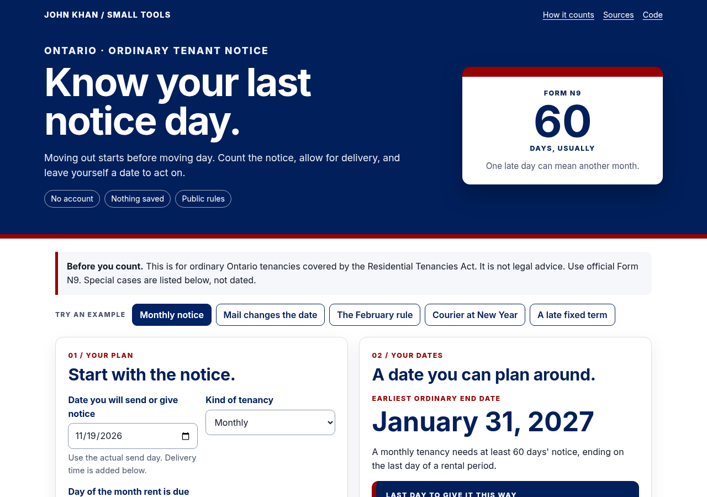

# Lease Exit Timer

**Live:** https://alenzacodes.github.io/lease-exit-timer/

Find the last day to give ordinary tenant notice in Ontario, with delivery time counted, and see the public rules the count uses.

A "60 days from today" calculator answers the wrong question. This page starts from the end date and counts backward through the way you will actually deliver the notice, by hand, mail, courier or email, so the answer is the last day to send it that way.



## The problem

Ending a lease in Ontario usually takes 60 days of notice on official Form N9, ending on the last day of a rental period. The hard part is the calendar. One late day can mean another month of rent, and two rules catch people out:

- Mail counts on the **fifth day after mailing**, not the day it is posted (Residential Tenancies Act, s. 191 (3)).
- Notice for the end of February or March has its **own short rule** (s. 44 (5)).

## What it does

1. Enter the day you will send or give notice, the kind of tenancy, and the rent day. For a fixed term, also enter the last day of the term as written in the lease. That date is checked first: empty, impossible, more than ten years out, or already over each get a plain message.
2. Pick how it will reach the landlord: by hand or mail box, Canada Post, courier, or email. Email needs two ticks: the landlord agreed in writing to service by email (LTB rule 3.5), and that consent covers a tenant's notice to end the tenancy.
3. Get the earliest ordinary end date, the last day to send notice that way, and a short timeline that shows the count. When the last mail or courier day is a weekend or holiday, the page also gives the last working day before it. Courier dates move past Saturdays, Sundays, statutory holidays and assumed Board office closures, and the page lists each day it skipped under those three headings.
4. Optionally enter the rent, and the page says what one day late would cost, for example "One day late costs about $1,850.00."
5. Fill in Form N9 from the checklist under the date: every field the tenant or representative must complete on the official form, in order, with the termination date written as dd/mm/yyyy. The Office Use Only box is for the Board.
6. Save the last day to your calendar with a one week reminder, print the plan, or copy a courtesy note. The courtesy note is not Form N9 and does not give notice.

Five example buttons show the main cases in one click: an ordinary monthly notice, mail moving the date a month, the February rule, a courier hand off on New Year's Eve, and a fixed term that is already too late.

## What it will not do

It is not legal advice and it does not file, send or sign anything. Yearly tenancies are not offered. Courier and email timing rest on the Board's Rules of Procedure, which are written mainly for Board matters. The page shows the chain in "How courier and email connect to the Act": RTA s. 191 (1) (g) allows "any other means allowed in the Rules", s. 2 (1) defines the Rules as the Board's rules of practice and procedure, rule 3.1 adds courier and, with written consent under rule 3.5, email, and rule 3.9 says when each counts. A day fixed as a holiday by proclamation, or an unplanned office closure, cannot be known ahead. Special paths on the N9 instructions (a refused assignment, an N12 or N13, care homes, the standard lease demand, and notice for tenants who have experienced violence) are listed and not dated, because they need facts the page does not ask for. Nothing you type leaves the browser.

## Run it

```bash
python3 -m http.server 8080 --directory site
```

Open http://localhost:8080/. There is no build step.

## Tests

```bash
npm test
```

- `tests/test_dates.mjs` has the 27 original worked examples.
- `tests/test_delivery.mjs` has 31 checks for mail, courier, email, rent days 29 to 31, late fixed terms, bad input and the calendar file.
- `tests/test_round2.mjs` has 55 checks for Ontario holidays in courier timing, the email consent guard, fixed term entry and the Form N9 checklist.
- `tests/test_round3.mjs` has 52 checks for the rent line, the last working send day, statutory holidays against assumed closures, the service chain and the Form N9 wording.
- `tests/test_property.mjs` is an independent oracle: it has its own hard coded holiday table for 2026 to 2029 and its own date maths, and shares no code with the engine. It checks 111,036 cases for every send day from 2026 to 2029, for monthly (seven rent days), weekly (seven pay days), daily, and fixed terms ending one to four months out, across four delivery methods. Each answer must match the oracle's earliest legal period end, last notice day and last send day. It also checks 1,461 courier hand offs and the four yearly holiday tables.
- `tests/browser_check.py` runs the page in Chromium at desktop and phone width, with five examples, the email and fixed term guards, the rent box, a Civic Holiday case, the service chain, and axe-core.

[docs/TESTING.md](docs/TESTING.md) explains what the tests found and what changed because of them. [docs/WALKTHROUGH.md](docs/WALKTHROUGH.md) is my own structured walkthrough of the page, labelled as a self review, not user testing.

## How it is built

- `site/dates.js` is the date engine: pure functions, shared by the browser and the Node tests.
- `site/data/rules.json` holds the rule text and source list shown on the page.
- `site/app.js` and `site/index.html` are the interface. Plain HTML, CSS and JavaScript, no framework, no tracking.
- GitHub Actions runs `npm test` and publishes `site/` to GitHub Pages.

## Sources

Read on 19 November 2026, America/Toronto.

- Residential Tenancies Act, 2006, S.O. 2006, c. 17, ss. 2 (1), 38, 44, 47 and 191: https://www.ontario.ca/laws/statute/06r17
- Legislation Act, 2006, S.O. 2006, c. 21, Sched. F, ss. 87, 88 (holidays) and 89 (3) (counting days): https://www.ontario.ca/laws/statute/06l21
- Form N9, Tenant's Notice to End the Tenancy (v. 01/04/2022): https://tribunalsontario.ca/documents/ltb/Notices%20of%20Termination%20%26%20Instructions/N9.pdf
- Landlord and Tenant Board Rules of Procedure, rules 1.1 (holiday), 3.1 (other methods), 3.5 and 3.6 (email consent) and 3.9 (when documents count as served): https://tribunalsontario.ca/documents/ltb/Rules/LTB-Rules_of_Procedure.html
- Landlord and Tenant Board, Consent to Service by Email (v. 01/04/2022): https://tribunalsontario.ca/documents/ltb/Other%20Forms/Email%20Service%20Consent.pdf
- A guide to the standard lease for rental housing: https://files.ontario.ca/mmah-guide-to-standard-lease-for-rental-housing-en-2022-04-19.pdf

## Credits

Built by John Khan, Toronto, Ontario, a current student, for Silicon Valley Buildathon. Solo project. Reused parts: none beyond the browser platform. The accessibility check uses axe-core and Playwright as test tools only; neither ships in the page.

## License

MIT. See [LICENSE](LICENSE).
