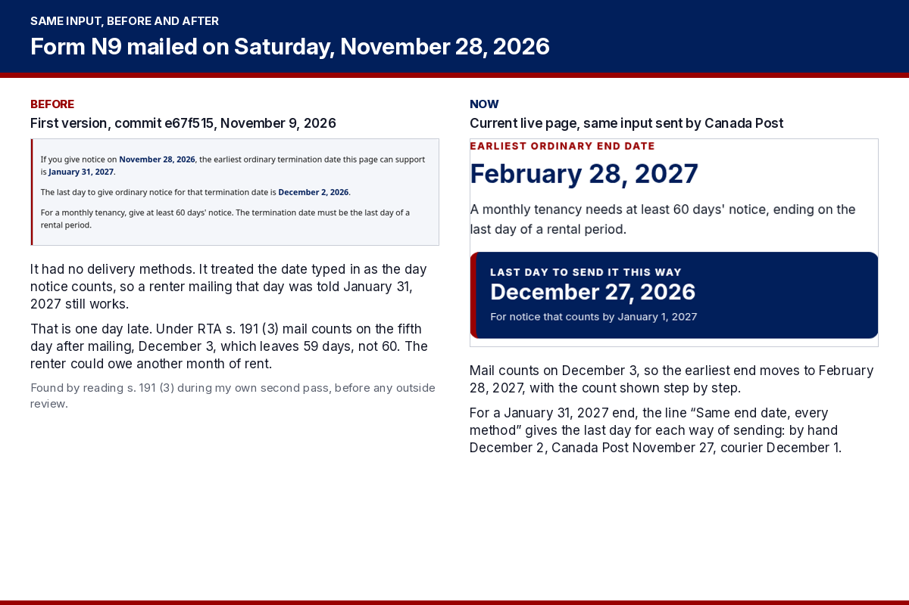

# Lease Exit Timer

**Live:** https://alenzacodes.github.io/lease-exit-timer/

Find the last day to give ordinary tenant notice in Ontario, with delivery time counted, and see the public rules the count uses.

The answer comes first, as one sentence you can act on, for example: "Send Form N9 by Canada Post by Thursday, December 24, 2026 to end your tenancy on February 28, 2027." Under it is the theoretical last mailing day on the literal text of s. 44 (5): Sunday, December 27, 2026. That is not a day with confirmed postal collection, and a letter put in a street box that Sunday may not be postmarked until Tuesday, December 29. Monday, December 28, 2026 is shown separately as a later day that works only on the author's reading of Legislation Act s. 89 (1), and Canada Post lists it as a holiday with no collection or delivery (Boxing Day observed).

**The safe end date leads.** When a notice reaches an earlier end date only on that reading, for example notice by hand on Saturday, January 2, 2027, the headline, the Form N9 checklist and the calendar reminder use the end date that meets the literal s. 44 (5) date, March 31, 2027. February 28, 2027 is shown on its own line, marked "Contingent, not advised".

**What is different.** A generic "60 days from today" count, for Form N9 mailed on Saturday, November 28, 2026, lands on January 27, 2027 and says the January 31 period end works. This page counts the notice on December 3, five days after mailing (s. 191 (3)), which leaves 59 days, so the earliest end is February 28, 2027 and the last day to mail for January 31 was November 27. It counts backward from the end date through the way you will actually deliver the notice, by hand, mail, courier or email, skips the days the rules skip, and shows the same end date for every method.

![A silent 36 second capture of v1.8.0, the current build, made by automated browser capture on November 20, 2026: a generic 60 day count from Saturday, November 28, 2026 against this page; Form N9 by Canada Post on November 28, where the page says send by Thursday, December 24, 2026 to end on February 28, 2027, and calls Sunday, December 27 only the theoretical last mailing day, with the advice to hand it over a post office counter and keep the dated receipt; the same end date by every method; then notice by hand on Saturday, January 2, 2027, where the headline is the safe end date, March 31, 2027, February 28 is marked "Contingent, not advised", and the Form N9 checklist says 31/03/2027.](docs/screenshots/10-current-build.gif)

**Video and erratum.** The walkthrough video (https://youtu.be/AasmHYBD09k) was recorded at commit `2746fc3`, before any rubric review, and it is kept as it is. Its closing card says the first brute force run covered 81,816 cases. That is wrong: the first run covered 20,454 cases and found 1,650 failures. 81,816 is the total after the fix, when the same 20,454 cases were run for each of four delivery methods ([docs/TESTING.md](docs/TESTING.md), section 1). It does not show anything changed after that commit. The GIF above and the screenshots in docs/screenshots (except the before and after image and the thumbnail) were captured from v1.8.0, the current build, so they show the theoretical last mailing day wording and the January 2 safe headline described above.



## The problem

Ending a lease in Ontario usually takes 60 days of notice on official Form N9, ending on the last day of a rental period. The hard part is the calendar. One late day can mean another rental period of rent (a month, for a monthly tenancy), and two rules catch people out:

- Mail counts on the **fifth day after mailing**, not the day it is posted (Residential Tenancies Act, s. 191 (3)).
- Notice for the end of February or March has its **own short rule** (s. 44 (5)).

## What it does

1. Enter the day you will send or give notice, the kind of tenancy, and the rent day. A note beside the rent day says to check the rental period in the lease, because the day you usually pay is not always proof of it. For a fixed term, also enter the last day of the term as written in the lease. That date is checked first: empty, impossible, more than ten years out, or already over each get a plain message.
2. Pick how it will reach the landlord: by hand or mail box, Canada Post, courier, or email. Email needs two ticks: the landlord agreed in writing to service by email (LTB rule 3.5), and that consent covers a tenant's notice to end the tenancy.
3. Read the decision first, one sentence with the last day to send and the end date. Under it is the earliest ordinary end date, the last day to send notice that way, a short timeline that shows the count, and one line with the last day for every method for the same end date. When the last legal send day is a weekend or a closure, the page leads with a practical send by day and shows the legal limit under it. For the end of February or March, the advised day always meets the literal January 1 or February 1 date in s. 44 (5); a later day that depends on the author's reading of Legislation Act s. 89 (1) is shown on its own line, marked as that reading. Mail uses Canada Post's official holiday calendar (December 25, December 28 as Boxing Day observed, and January 1 in this window). The calendar does not promise weekend collection, and post offices run inside other stores keep the store's hours, so the page does not count a Saturday or Sunday as a mailing day, calls a weekend or holiday legal limit the theoretical last mailing day, and advises handing the letter over a post office counter, not into a street box, with a dated receipt as evidence of the mailing day. If no counter can accept it by the advised day, the page says not to count on a street box or a later postmark and points to the last day by hand, or to email with written consent. Canada Post has published 2026 and 2027; the dates for 2028 to 2035 are calculated by this page and labelled that way. Courier dates move past Saturdays and Sundays, which LTB rule 1.1 names as holidays, and past weekdays when the Board's offices may be closed: the Legislation Act s. 88 holidays, Civic Holiday, and December 28 when Boxing Day falls on a weekend. The courier send by day assumes no Saturday pickup, and the page says so. Rule 1.1 turns on actual office closures and no Board closure calendar could be found, so weekends are labelled VERIFIED and those weekdays UNKNOWN, counted as closed, and the page says when one changes the end date. A "Why this date" section explains the count, the closures and any holiday extension of a deadline.
4. Optionally enter the rent, and the page says how far one day late moves the end date, in the tenancy's own unit: one month for a monthly tenancy, one week for a weekly one, one day for a daily one. For example "Missing the last day by one day moves the end date by 1 month, about $1,850.00 more rent", or for a weekly tenancy at $400, "by 1 week, about $400.00". It says this is an estimate, not a bill, and that s. 16 of the Act gives a landlord who claims rent a duty to minimize losses.
5. Fill in Form N9 from the checklist under the date: every field the tenant or representative must complete on the official form, in order, with the termination date written as dd/mm/yyyy. The Office Use Only box is for the Board.
6. Save the last day to your calendar with a one week reminder, print the plan, or copy a courtesy note. The courtesy note is not Form N9 and does not give notice.

Five example buttons show the main cases in one click: an ordinary monthly notice, mail moving the date a month, the February rule, a courier hand off on New Year's Eve, and a fixed term that is already too late.

## What it will not do

It is not legal advice and it does not file, send or sign anything. Yearly tenancies are not offered. Courier and email timing rest on the Board's Rules of Procedure, which are written mainly for Board matters. The page shows the chain in "How courier and email connect to the Act": RTA s. 191 (1) (g) allows "any other means allowed in the Rules", s. 2 (1) defines the Rules as the Board's rules of practice and procedure, rule 3.1 adds courier and, with written consent under rule 3.5, email, and rule 3.9 says when each counts. A day fixed as a holiday by proclamation, or an unplanned office closure, cannot be known ahead. The January 1 and February 1 deadlines in s. 44 (5) are fixed dates, and the advised day always meets them. Legislation Act s. 89 (1) extends a time limit that would otherwise expire on a holiday to the next day that is not a holiday. On the author's reading that applies here, so January 1, 2027 would run to Saturday, January 2, 2027. No tribunal or court decision applying s. 89 (1) to these dates is cited, so the page shows January 2 only as that reading, and when a notice reaches its end date only through it, the page leads with the end date the literal date gives and shows the earlier one only as a contingent line. Section 44 (5) is also worded as a deeming rule ("shall be deemed to have given at least 60 days notice"), not a time limit, which makes that reading weaker still. It covers notice under s. 44 (2), (3) and (4), so it applies to monthly and fixed term tenancies here, and never to daily or weekly ones. LTB rule 1.15 lets a notice be delivered on a holiday, so giving it by hand on January 1 needs no extension. LTB rule 1.14, through RTA s. 193, could be read to reach Monday, January 4, 2027; the page names that day and does not rely on it. The 60 and 28 day minimum periods are not extended. Special paths on the N9 instructions (a refused assignment, an N12 or N13, care homes, the standard lease demand, and notice for tenants who have experienced violence) are listed and not dated, because they need facts the page does not ask for. Nothing you type leaves the browser.

## Run it

```bash
python3 -m http.server 8080 --directory site
```

Open http://localhost:8080/. There is no build step.

## Tests

```bash
npm test
```

- `tests/test_dates.mjs` has the 27 original worked examples, plus one more from round 8 (28 checks).
- `tests/test_delivery.mjs` has 31 checks for mail, courier, email, rent days 29 to 31, late fixed terms, bad input and the calendar file.
- `tests/test_courier_email_and_n9.mjs` has 55 checks for Ontario holidays in courier timing, the email consent guard, fixed term entry and the Form N9 checklist.
- `tests/test_statutory_service_and_n9.mjs` has 53 checks for the rent line, the last legal and practical send days, statutory holidays against assumed closures, the service chain, the Form N9 wording, and the Boxing Day mail note.
- `tests/test_closures_methods_and_limits.mjs` has 40 checks for the s. 88 weekend rules (January 1, 2028 on a Saturday adds no Monday; Canada Day 2029 moves to July 2), weekday holidays as assumed office closures, the date if the offices were open, the every method line, the rent estimate wording and the rental period note.
- `tests/test_deadlines_and_rent.mjs` has 60 checks (43 in round 4, 59 in round 5, 60 from round 8) for the s. 89 (1) extension of the January 1 and February 1 deadlines (2026, 2027, 2028, 2029 and 2034), the rule 1.14 day the page does not rely on, the minimum periods that are not extended, the VERIFIED and UNKNOWN closure labels, the Canada Post calendar (including Boxing Day observed on December 28), the practical send by day against the legal limit, the decision sentence and "Why this date", and the late rent estimate for weekly, daily, monthly and fixed term tenancies.
- `tests/test_literal_deadline_and_closures.mjs` has 91 checks (87 when it was added in round 7, 4 more in round 8): the literal s. 44 (5) day against the author's reading for hand, email and mail, a notice that only works on that reading, February 1, 2026 on a Sunday, December 28 as an UNKNOWN courier closure in 2026, 2027 and 2032, the Canada Post wording and dated receipt advice, the courier Saturday note, computed Canada Post years 2028 to 2035 (September 30, Remembrance Day, Civic Holiday, Good Friday and Easter Monday each year), and the s. 88 (2) and rule 1.15 wording.
- `tests/test_safe_headline_and_mailing_day.mjs` has 44 checks for round 8: the safe literal end date as the headline, on the Form N9 checklist and in the reminder, with a scan of 14,608 notices from 2026 to 2035; the exact s. 44 (5) text and its scope for fixed, weekly and daily tenancies; the theoretical last mailing day, the December 29 postmark and the receipt as evidence; Canada Post's published 2026 and 2027 rows kept apart from calculated 2028 to 2035 rows; and a scan of the repository wording.
- `tests/test_mailing_safeguards_and_email.mjs` has 14 checks for round 9: for the November 28 mail case, the advice to hand the letter over a post office counter, not into a street box, and what to do if no counter can accept it by December 24 (the last day by hand, January 1, 2027, is later, and email needs written consent); that no wording calls a street box a safe mailing; and LTB rule 3.9, which counts an email on the day it was sent and sets no time of day cutoff, in `rules.json` and on the page.
- `tests/test_property.mjs` checks the engine against an oracle with its own hard coded holiday table for 2026 to 2029, its own date maths and its own reading of the s. 89 (1) extension. It imports only the two engine functions it tests, compute() and holidaysIn(). The code is independent, but the reading of the law is not: I typed the table from the same reading of s. 88 and LTB rules 1.1 and 3.9, so a shared misreading would pass both. It checks 111,036 cases for every send day from 2026 to 2029, for monthly (seven rent days), weekly (seven pay days), daily, and fixed terms ending one to four months out, across four delivery methods. Each answer must match the oracle's earliest legal period end, last notice day, last send day and, from round 7, the last send day on the literal s. 44 (5) date. From round 8 it also checks 64,284 headline cases: the headline end date must meet the literal date, and the contingent end date must match the oracle's own extended reading. It also checks 1,461 courier hand offs (skipped days, their kinds, the date if the offices were open, and the every method line) and the four yearly holiday tables.
- `tests/browser_check.py` runs the page in Chromium at desktop and phone width, with five examples, the email and fixed term guards, the rent box, the every method line, a Civic Holiday case, a weekly rent case, the January 2, 2027 safe headline, the decision sentence, the short live summary that a screen reader would announce, the deadline extension note, the service chain, the mail counter safeguard, the rule 3.9 email note, and axe-core in 16 page states.

[docs/TESTING.md](docs/TESTING.md) explains what the tests found and what changed because of them. [docs/WALKTHROUGH.md](docs/WALKTHROUGH.md) is my own structured walkthrough of the page, labelled as a self review, not user testing.

## How it is built

- `site/dates.js` is the date engine: pure functions, shared by the browser and the Node tests.
- `site/data/rules.json` holds the rule text and source list shown on the page.
- `site/app.js` and `site/index.html` are the interface. Plain HTML, CSS and JavaScript, no framework, no tracking.
- GitHub Actions runs `npm test` and publishes `site/` to GitHub Pages.

## Sources

Read on 19 November 2026, America/Toronto. The Board's Rules of Procedure (effective September 1, 2021, updated September 21, 2026) were read again on 20 November 2026 to confirm that rule 3.9 counts an email as served on the day it was sent and sets no time of day cutoff; the rules contain no 5 p.m. or evening cutoff for service by email.

- Residential Tenancies Act, 2006, S.O. 2006, c. 17, ss. 2 (1), 16, 38, 44, 47, 191 and 193 (s. 44 (5) is quoted word for word in `site/data/rules.json`): https://www.ontario.ca/laws/statute/06r17
- Legislation Act, 2006, S.O. 2006, c. 21, Sched. F, ss. 87 and 88 (holidays; Sunday is in s. 88 (2)), 89 (1) (a time limit that ends on a holiday) and 89 (3) (counting days): https://www.ontario.ca/laws/statute/06l21
- Form N9, Tenant's Notice to End the Tenancy (v. 01/04/2022): https://tribunalsontario.ca/documents/ltb/Notices%20of%20Termination%20%26%20Instructions/N9.pdf
- Landlord and Tenant Board Rules of Procedure, rules 1.1 (holiday), 1.14 (time ending on a holiday), 1.15 (delivery on a holiday), 3.1 (other methods), 3.5 and 3.6 (email consent) and 3.9 (when documents count as served): https://tribunalsontario.ca/documents/ltb/Rules/LTB-Rules_of_Procedure.html
- Landlord and Tenant Board, Consent to Service by Email (v. 01/04/2022): https://tribunalsontario.ca/documents/ltb/Other%20Forms/Email%20Service%20Consent.pdf
- A guide to the standard lease for rental housing: https://files.ontario.ca/mmah-guide-to-standard-lease-for-rental-housing-en-2022-04-19.pdf
- Canada Post official holiday schedule: https://www.canadapost-postescanada.ca/cpc/en/support/kb/other-products-services/post-office/find-out-operating-hours-on-holidays.page

## Credits

Built by John Khan, Toronto, Ontario, for Silicon Valley Buildathon (event window November 8 to December 15, 2026; first commit `e67f515` on November 9, 2026). John is a current student and is above the age of majority in Ontario. Solo project. ALENZACODES is John's personal GitHub handle, not a company or organization. Reused parts: none beyond the browser platform. The accessibility check uses axe-core and Playwright as test tools only; neither ships in the page.

## License

MIT. See [LICENSE](LICENSE).
